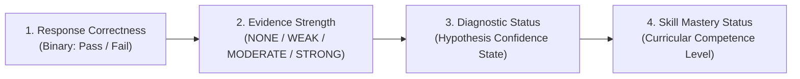
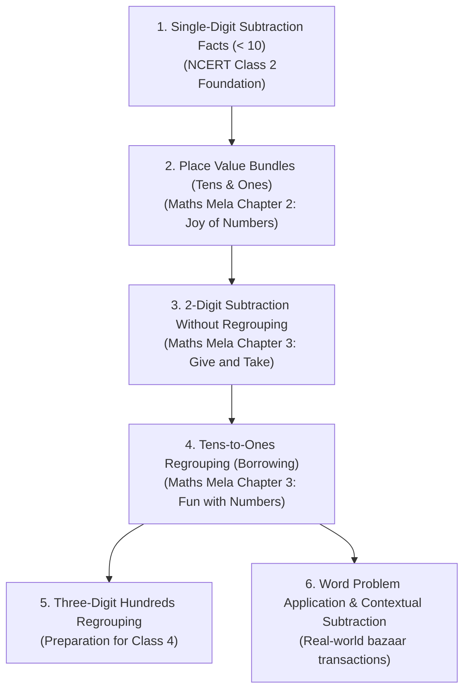

# ReasonFirst: Diagnostic Methodology & Cognitive Psychometric Foundations

## 1. Executive Summary & Foundational Tenet

ReasonFirst provides an evidence-based cognitive diagnostic and instructional intervention framework for foundational primary mathematics. Aligned with the National Council of Educational Research and Training (**NCERT**) Class 3 curriculum (*Maths Mela*), the system rejects arbitrary percentage-based scoring (e.g. "87% mastery") in favor of explainable, multi-source evidence synthesis.

The central tenet of ReasonFirst is:

> **"Diagnose through evidence, preserve uncertainty, recommend through pedagogy, and measure through reassessment."**

---

## 2. Distinction of Core Diagnostic Concepts

A critical failure in automated assessment tools is conflating test-item correctness with cognitive mastery, or treating an isolated error as proof of a deep misconception. ReasonFirst explicitly separates four distinct pedagogical constructs:

### 2.1. Response Correctness
- **Definition**: The arithmetic correctness of a single student response relative to the probe's true mathematical value.
- **Values**: `Pass` (Correct) or `Fail` (Incorrect).
- **Rule**: An isolated correct answer *never* establishes skill mastery; an isolated incorrect answer *never* establishes a misconception.

### 2.2. Evidence Strength
- **Definition**: The statistical and procedural weight of accumulated observations across multiple diagnostic probes, control items, and verbal reasoning interactions.
- **Levels**:
  - `NONE`: No valid assessment evidence recorded.
  - `WEAK`: 1-2 probes observed, or verbal reasoning is missing/uninformative. Preliminary observations only.
  - `MODERATE`: Partial probe set (e.g., 2 regrouping probes) or single probe corroborated by explicit verbal reasoning.
  - `STRONG`: Complete probe set (3+ regrouping probes with unanimous error signatures) and verified baseline non-regrouping control items.

### 2.3. Diagnostic Status
- **Definition**: The clinical confidence state of an automated diagnostic hypothesis regarding student misconceptions.
- **States**:
  - `INSUFFICIENT_EVIDENCE`: Fewer than minimum required probes administered (< 3 probes). No conclusion can be drawn.
  - `AMBIGUOUS_PATTERN`: Inconsistent responses across probes (e.g., one Smaller-From-Larger, one Borrow-Without-Decrement, or failed baseline controls). Indicates calculating instability or guessing.
  - `CANDIDATE_MISCONCEPTION`: A single probe or preliminary response exhibited a known error signature. Strictly preserved as a tentative hypothesis with `confidence: "LOW"`.
  - `SUPPORTED_HYPOTHESIS`: Multiple consistent probes and/or explicit conversational reasoning confirm the underlying procedural bug.
  - `CONTRADICTED_HYPOTHESIS`: Verbal explanation or scratchpad evidence demonstrates correct conceptual procedure despite a recorded calculation slip.
  - `NO_TARGET_PATTERN_DETECTED`: Student solved probes correctly or made unsystematic slips without matching modeled misconception signatures.

### 2.4. Skill Mastery Status
- **Definition**: The long-term pedagogical readiness of a student on a specific curricular learning standard.
- **States**:
  - `NOT_ASSESSED`: No diagnostic probes administered for this skill standard.
  - `INSUFFICIENT_EVIDENCE`: Incomplete probe set; mastery status cannot be inferred.
  - `DEVELOPING`: Active candidate misconception detected or intermittent success requiring instructional scaffolding.
  - `PROVISIONALLY_SECURE`: Demonstrated correct procedure on target probe; requires transfer verification on non-identical items.
  - `SECURE`: Consistent correct execution across multiple probes, non-regrouping controls, and non-identical transfer problems.

---

## 3. Cognitive Diagnostic Modeling: Psychometric Architecture

### 3.1. Deterministic Expert Rules vs. Heuristic DINA Model
ReasonFirst employs a hybrid psychometric architecture:
1. **Deterministic Misconception Signatures**: Exact mathematical algorithms modeling systematic procedural errors identified in educational research (e.g., VanLehn, 1990; Resnick, 1982).
2. **Deterministic Input, Noisy "And" (DINA) Formulation**: Cognitive diagnostic model relating binary latent skill mastery vectors $\boldsymbol{\alpha} \in \{0, 1\}^K$ to item responses:
   $$\eta_{ij} = \prod_{k=1}^K \alpha_{ik}^{q_{jk}}$$
   where $q_{jk}$ represents the $Q$-matrix mapping of item $j$ to skill $k$, and the item response probability is parameterized by slip $s_j$ and guess $g_j$:
   $$P(Y_{ij} = 1 \mid \boldsymbol{\alpha}_i) = g_j^{1 - \eta_{ij}} (1 - s_j)^{\eta_{ij}}$$

### 3.2. Parameter Calibration Transparency & Scientific Boundaries
In strict compliance with software and research integrity:
- **Predefined Heuristic Parameters**: The parameters in `calibrated_diagnostic_model.json` were derived from heuristic pedagogical baselines ($s \approx 0.08 - 0.12$, $g \approx 0.10 - 0.15$ for multiple-choice distractors) in `train.py`.
- **Field Calibration Disclaimer**: These parameters are **not** claimed to be calibrated against a longitudinal empirical cohort of Indian primary school students. True empirical calibration requires an IRB-approved field study with a sample size of $N \ge 500$ students across diverse linguistic contexts. Until such data is gathered, ReasonFirst treats Bayesian probabilities as exploratory and grounds clinical diagnoses in transparent deterministic evidence thresholds.

---

## 4. Modeled Misconception Signatures in Foundational Subtraction

The engine models explicit buggy arithmetic procedures:

| Misconception Signature | Underlying Cognitive Hurdle | Example Probe | Distractor Produced | Pedagogical Diagnosis |
| :--- | :--- | :--- | :--- | :--- |
| **`SMALLER_FROM_LARGER`** | Child subtracts smaller digit from larger digit in each column, reversing direction when top digit is smaller ($4 - 1 = 3$). | $61 - 24$ | **$43$** | Child treats subtraction as symmetric; fails to recognize place value unbundling necessity. |
| **`BORROW_WITHOUT_DECREMENT`** | Child unbundles 1 ten to make 11 ones ($11 - 4 = 7$), but forgets to decrement top tens digit ($6 - 2 = 4$). | $61 - 24$ | **$47$** | Regrouping procedure initiated in ones column but not carried through to the tens column. |
| **`OPERATION_CONFUSION_ADD`** | Child performs addition instead of subtraction across columns ($1 + 4 = 5, 6 + 2 = 8$). | $61 - 24$ | **$85$** | Symbol confusion or operational perseveration. |
| **`PLACE_VALUE_GAP`** | Column alignment or place value order confused. | $61 - 24$ | Distractor variant | Deficit in base-10 bundling understanding. |

---

## 5. NCERT Class 3 Foundational Curriculum Alignment

ReasonFirst is explicitly anchored in the **NCERT Class 3 Mathematics** curriculum (*Maths Mela* / आनंदमय गणित):

### 5.1. Clinical Remediation Protocols Using Concrete Manipulatives
Every identified misconception is mapped to an NCERT-aligned concrete intervention:
1. **Matchstick Bundles & Rajma Seeds (NCERT Ch. 3)**:
   - *Materials*: Matchstick bundles tied in tens with rubber bands, loose seeds.
   - *Protocol*: Child represents 61 as 6 bundles of ten and 1 loose seed on a 2-column place value mat. To take away 4 loose seeds, the child must physically untie one ten-bundle into 10 loose units, observing that only 5 bundles remain before removing 4 loose seeds.
2. **The Banker's Exchange Game**:
   - *Materials*: Token currency of ₹10 notes and ₹1 coins.
   - *Protocol*: Child trades one ₹10 note at the bank for ten ₹1 coins when coins are insufficient to make change.
3. **Ginladi Bead String**:
   - *Materials*: 100-bead string with alternating groups of 10 red and 10 white beads.
   - *Protocol*: Moving beads backwards along the line to anchor relative magnitude and distance.

---

## 6. Pre/Post Intervention Reassessment & Progress Measurement

To avoid unsupported claims of pedagogical efficacy, ReasonFirst implements a strict observational comparison protocol:
- **Non-Identical Transfer Probes**: Post-intervention reassessment never administers identical question items; it serves isomorphic transfer items with identical regrouping requirements (e.g. testing $52 - 18$ after remediating $61 - 24$).
- **Conservative Observational Reporting**: The engine uses non-causal language:
  - `IMPROVEMENT_OBSERVED`: "Improvement observed after intervention. Student demonstrated accurate place value regrouping across reassessment probes including transfer problems."
  - `PERSISTING_PATTERN`: "Candidate misconception persists after intervention. Recommend Tier 2 concrete manipulative intervention."
  - `PARTIAL_PROGRESS`: "Candidate misconception not systematically observed; mixed responses indicate emerging procedural stability."

---

## 7. Model Boundaries & Limitations

ReasonFirst explicitly documents what it **CAN** and **CANNOT** do:
- **CAN**: Reliably identify known, systematic buggy arithmetic algorithms when supported by unanimous multi-probe response patterns or explicit verbal confirmations.
- **CAN**: Flag incomplete assessments and refuse to issue definitive diagnoses on insufficient evidence.
- **CAN**: Provide teachers with structured, concrete classroom remediation protocols.
- **CANNOT**: Infer psychological causes (e.g. math anxiety, dyslexia, attention deficit) from arithmetic quiz responses.
- **CANNOT**: Claim universal pedagogical causation; observed improvements reflect test performance change and require teacher verification in natural classroom settings.

