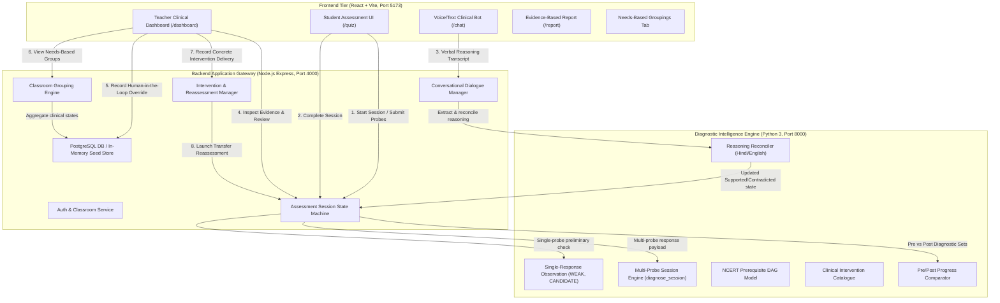
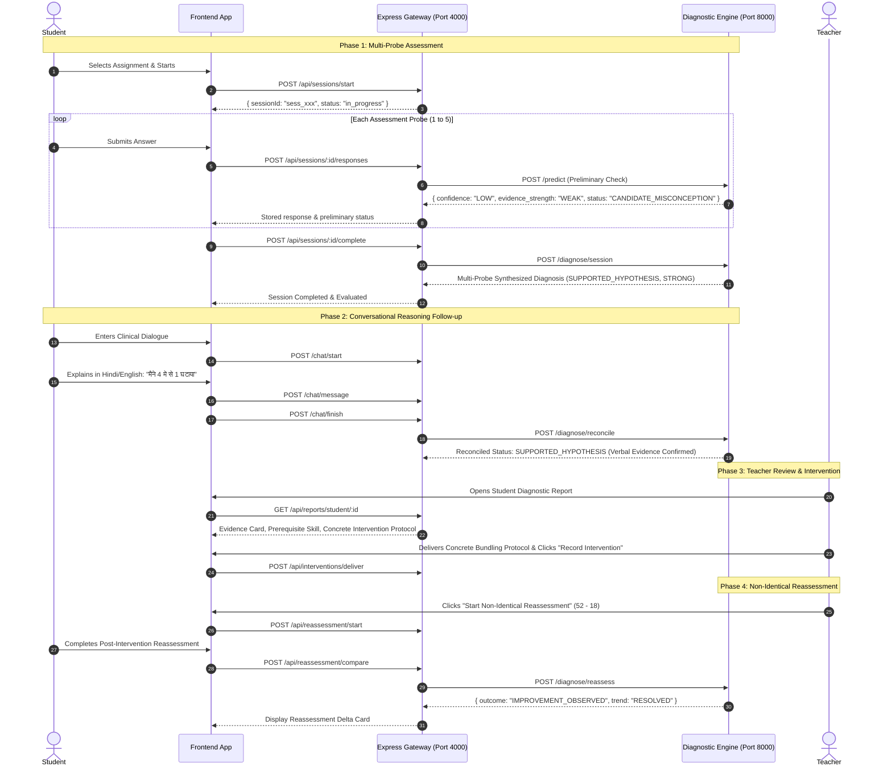

# ReasonFirst: Diagnostic Intelligence System Architecture

## 1. Architectural Overview & Design Philosophy

ReasonFirst is an evidence-driven learning diagnosis, conversational reasoning, and instructional intervention system aligned with NCERT Class 3 foundational mathematics (*Maths Mela*). The system rejects arbitrary percentage scoring and instead adheres to the core pedagogical principle:

> **"Diagnose through evidence, preserve uncertainty, recommend through pedagogy, and measure through reassessment."**

The platform operates across three tightly integrated runtime tiers:
1. **Frontend Presentation & Child Interface** (`React 19`, `Vite`, `Tailwind CSS`, `Lucide Icons`): Mobile-first progressive web application hosting student assessment sessions, bilingual (Hindi/English) conversational interviews, teacher clinical reviews, and needs-based classroom grouping management.
2. **Backend Application Gateway & Orchestration Layer** (`Node.js`, `Express 5`): Manages authentication, multi-probe assessment session state machines, dialogue persistence, human-in-the-loop teacher overrides, and proxy routing to the Python diagnostic engine.
3. **Cognitive Diagnostic Intelligence Engine** (`Python 3.11`, `FastAPI` / HTTP Microservice): Houses deterministic misconception signature extractors, cognitive skill prerequisite graphs, qualitative multi-probe evidence synthesizers, conversational reasoning reconcilers, and pre/post intervention delta calculators.

---

## 2. End-to-End System Architecture

---

## 3. Subsystem Breakdown & Component Responsibilities

### 3.1. Frontend Tier (`frontend/`)
- **`src/pages/QuestionSolving.jsx`**: Manages active assessment sessions. Initializes session ID via `POST /api/sessions/start`, validates probe membership against the active assignment, submits individual probe responses via `POST /api/sessions/:id/responses`, and executes final synthesis upon session completion via `POST /api/sessions/:id/complete`.
- **`src/pages/DiagnosticReport.jsx`**: Teacher-facing clinical dashboard presenting transparent evidence rather than fabricated percentages:
  - Qualitative evidence strength badges (`STRONG`, `MODERATE`, `WEAK`).
  - Diagnostic hypothesis state (`SUPPORTED_HYPOTHESIS`, `CANDIDATE_MISCONCEPTION`, `AMBIGUOUS_PATTERN`, `INSUFFICIENT_EVIDENCE`, `CONTRADICTED_HYPOTHESIS`, `NO_TARGET_PATTERN_DETECTED`).
  - Cognitive Skill Mastery status matrix (`SECURE`, `PROVISIONALLY_SECURE`, `DEVELOPING`, `INSUFFICIENT_EVIDENCE`, `NOT_ASSESSED`).
  - Prerequisite diagnostic card with NCERT curriculum mappings and recommended diagnostic check probes.
  - Concrete manipulative intervention protocol with "Record Intervention Delivered" tracking.
  - Non-identical reassessment launch button and pre/post delta comparison.
- **`src/pages/TeacherDashboard.jsx`**: Features dual-view interface:
  - Standard Student Roster with pending clinical review filtering.
  - NCERT Needs-Based Flexible Groupings with student assignment, pedagogical goals, and recommended classroom activities.
- **`src/services/api.js`**: Standardized client SDK encapsulating all session lifecycle, diagnostic evaluation, chat dialogue, intervention recording, and grouping APIs.

### 3.2. Backend Application Gateway (`backend/`)
- **`server.js`**: Express server mounting all core API endpoints, orchestrating session lifecycle, human-in-the-loop clinical overrides, and cross-tier data synchronization.
- **`services/mlService.js`**: Robust integration bridge communicating with Python diagnostic engine at `http://127.0.0.1:8000`, equipped with timeout resilience and deterministic local fallbacks.
- **`chat/chatRoutes.js`**: Dialogue coordinator linking the student voice/text interview to clinical diagnostic records. Concluding dialogue triggers `mlService.reconcileReasoning()` to feed child verbal explanations back into the diagnostic evidence record.
- **`migrations/003_diagnostic_intelligence.sql`**: Database migration introducing relational schemas for `assessment_sessions`, `session_diagnoses`, `intervention_records`, and `reassessment_comparisons`.

### 3.3. Python Diagnostic Intelligence Engine (`ml_model/math-diagnostic-ml/`)
- **`src/math_diagnostic/engine.py`**:
  - `diagnose_single_response()`: Returns preliminary qualitative observation with explicit `confidence: "LOW"` and `evidence_strength: "WEAK"`. Never declares a definitive misconception or mastery from an isolated question.
  - `diagnose_session()`: Evaluates multi-probe response vectors (3-5 items including non-regrouping controls). Computes consensus across probe items, checks control consistency, and outputs qualitative status and skill mastery.
  - `reconcile_reasoning()`: Analyzes student natural language explanations in Hindi or English. Transitions hypotheses to `SUPPORTED_HYPOTHESIS` or `CONTRADICTED_HYPOTHESIS` based on intermediate mathematical operations, or retains `INCONCLUSIVE`/`CANDIDATE_MISCONCEPTION` if explanation is uninformative.
  - `compare_reassessment()`: Compares pre- and post-intervention diagnostic states, outputting conservative observational summaries (`IMPROVEMENT_OBSERVED`, `PERSISTING_PATTERN`, `PARTIAL_PROGRESS`).
  - `PREREQUISITE_GRAPH`: Directed Acyclic Graph (DAG) of foundational NCERT Class 3 mathematical competencies.
  - `INTERVENTION_CATALOGUE`: Structured clinical remediation protocols using concrete manipulatives (Dienes blocks, matchstick bundles, rajma seeds, ginladi bead strings).
- **`server.py`**: High-performance HTTP server exposing `/diagnose/session`, `/diagnose/reconcile`, `/diagnose/reassess`, `/prerequisites`, and `/interventions`.

---

## 4. Complete Assessment & Clinical Intervention Lifecycle

---

## 5. Security, State Resilience & Classroom Error Handling

1. **Duplicate Submission Protection**: `POST /api/sessions/:id/responses` validates whether a response for the target `questionId` has already been recorded in that session. Duplicate attempts are rejected with `HTTP 409 Conflict`.
2. **Session Probe Membership Validation**: Probes submitted must exist in the active assignment manifest. Unregistered probes are rejected with `HTTP 400 Bad Request`.
3. **Incomplete Assessment Protection**: Sessions with fewer than minimum required probes cannot be marked diagnostically complete and default to `STATUS_INSUFFICIENT_EVIDENCE`.
4. **Resilient In-Memory Fallback**: When PostgreSQL (`DATABASE_URL`) is not connected, the backend automatically operates in an in-memory development mode seeded with default credentials (`teacher@demo.com` / `password123`) and classroom `3A`, guaranteeing continuous local operability for teacher demonstrations.
5. **Human-in-the-Loop Override Integrity**: Automated machine learning diagnoses are never irreversible; teacher overrides are stored with clinical timestamps and notes, preserving teacher pedagogical authority.

