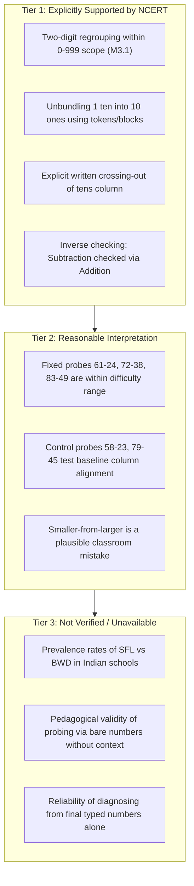

# NCERT Curriculum Alignment Research Report (Class 3 Mathematics)

## Executive Summary
This report evaluates the alignment between the Class 3 subtraction diagnostic prototype and official primary curriculum materials published by the National Council of Educational Research and Training (NCERT), New Delhi, India.

The evaluation examines two core official textbooks and national learning outcome standards:
1. ***Math-Magic Book 3*** (NCERT, National Curriculum Framework 2005 edition, reprinted up to 2023).
2. ***Maths Mela*** (NCERT, New Textbook for Grade 3 under NCF-SE 2023 / NEP 2020, published 2024).
3. ***Learning Outcomes at the Elementary Stage*** (NCERT Department of Elementary Education, 2019).

---

## 1. Official Primary Sources Located

| Source Identifier | Title | Edition / Year | Publisher & Department | Chapter & Topic Focus | Official URL |
| :--- | :--- | :--- | :--- | :--- | :--- |
| **Source A** | *Math-Magic Book 3: Textbook in Mathematics for Class III* | 2006 (Reprinted up to 2023) | NCERT, Publication Division | Chapter 3: "Give and Take" (pp. 29–45) Chapter 6: "Fun with Give and Take" (pp. 76–94) | [NCERT Portal (cemh103.pdf / cemh106.pdf)](https://ncert.nic.in/textbook.php) |
| **Source B** | *Maths Mela: Textbook of Mathematics for Grade 3* | 2024 (First Edition under NCF-SE 2023) | NCERT, Publication Division | Chapter 12: "Give and Take" Chapter 3: "Double Century" Chapter 6: "House of Hundreds" | [NCERT Portal (Maths Mela)](https://ncert.nic.in/textbook.php) |
| **Source C** | *Learning Outcomes at the Elementary Stage* | 2019 | NCERT (Department of Elementary Education) | Mathematics Class III: Curricular Expectations & Code M3.1 | [NCERT LO Document](https://ncert.nic.in) |

---

## 2. Evidence by Curricular Dimension

### 2.1 Meaning and Concept of Subtraction
* **Explicitly supported by source:**
  - In *Math-Magic Book 3*, Chapter 6 ("Fun with Give and Take", pp. 76–80), subtraction is introduced through real-life contexts: cricket scores (India needing runs to win: $236 - 123$), shopping for books (Geeta's purse: ₹368 − ₹123 = ₹245), and grocery purchasing (Nabeela buying ghee: ₹245 − ₹127).
  - Subtraction is conceptualized as **finding how much is left (reduction)**, **finding how much more is needed (comparison / difference)**, and the **inverse of addition** (checking subtraction using addition, p. 80).
  - In the new *Maths Mela* (2024), Chapter 12 ("Give and Take"), subtraction is introduced via plant nursery distributions, counting saplings, and exchange systems.

### 2.2 Place Value and Tens/Ones Representations
* **Explicitly supported by source:**
  - Both textbooks anchor multi-digit calculation in concrete and pictorial place-value models:
    - *Math-Magic Book 3* (pp. 78–82): Uses **Token Cards**: square yellow cards for $[100]$, oval/triangular green cards for $[10]$, and small red triangular cards for $[1]$.
    - *Maths Mela* (2024, Chapter 12): Uses **Dienes blocks (HTO base-10 blocks)**, place value tables, and open number lines.
  - Numbers are broken into explicit place values (e.g., $245$ is explicitly drawn as two $[100]$ cards, four $[10]$ cards, and five $[1]$ cards).

### 2.3 Subtraction Involving Regrouping or Exchanging
* **Explicitly supported by source:**
  - In *Math-Magic Book 3*, Chapter 6, page 78 ("Can you help Nabeela?"):
    - The problem ₹245 − ₹127 is solved step-by-step using token cards.
    - The text explicitly states: *"We cannot take 7 ones from 5 ones. So, one 10-token is exchanged for ten 1-tokens."*
    - The diagram shows crossing out one green $[10]$ card and drawing ten red $[1]$ cards, resulting in three $[10]$ cards and fifteen $[1]$ cards.
    - Subtraction is executed column-by-column: $15 - 7 = 8$ ones; $3 - 2 = 1$ ten; $2 - 1 = 1$ hundred $\implies$ answer ₹118.
  - In *Learning Outcomes at the Elementary Stage* (NCERT 2019, Outcome **M3.1**):
    - *"Solves simple daily life problems using addition and subtraction of three-digit numbers with and without regrouping, where sums/numbers do not exceed 999."*

### 2.4 Expected Calculation Methods
* **Explicitly supported by source:**
  - NCERT explicitly teaches **multiple alternative strategies**, not a single rigid column algorithm:
    1. **Manipulative Token Exchange:** Crossing out and swapping 10s for 10 ones.
    2. **Mental Decomposition by Tens and Ones:** Breaking the subtrahend into tens and ones (e.g., subtracting 20 first, then subtracting 4).
    3. **100-Chart / Number Line Jumps:** In *Math-Magic* Chapter 3 (pp. 29–35, "Kittu's Home"), subtraction is executed as jumping backward on a 1–100 grid (e.g., jumping up/down by 10s and left/right by 1s).
    4. **Standard Vertical Algorithm with Written Crossing-Out:** Taught in Chapter 6 after token manipulation.

### 2.5 Expected Level of Written Working
* **Explicitly supported by source:**
  - Written intermediate scratchwork is explicitly modelled:
    - When regrouping, children are instructed to cross out the original tens digit and write the decremented digit above it (e.g., crossing out $4$ and writing $3$).
    - Children write the regrouped ones count (e.g., $15$) above the ones column.
    - Checking answers by adding back the difference to the subtrahend ($118 + 127 = 245$) is heavily emphasized as standard written practice.

---

## 3. Categorization of Findings

### 3.1 Explicitly Supported by Primary Sources
1. Subtraction with regrouping across 2-digit and 3-digit numbers is a mandatory Class 3 learning outcome (**M3.1**).
2. The concept of "borrowing" is pedagogically grounded as "unbundling/exchanging" 1 ten for 10 ones using concrete/pictorial tokens.
3. Written notation requires crossing out the tens digit and writing the new reduced value above the column.
4. Checking subtraction by addition is a standard textbook method.

### 3.2 Reasonable Pedagogical Interpretations
1. The numbers selected for the project's 5 probes ($61 - 24$, $72 - 38$, $83 - 49$, $58 - 23$, $79 - 45$) fall comfortably within the numerical range expected of Class 3 learners.
2. The error signature *Smaller-From-Larger* ($4 - 1 = 3$) is a direct violation of the unbundling rule demonstrated on page 78 of *Math-Magic Book 3*.
3. The error signature *Borrow-Without-Decrement* ($11 - 4 = 7$ with $6 - 2 = 4$) represents a failure to execute the crossing-out step taught in the textbook.

### 3.3 Not Verified / Unavailable from Sources
1. **No Error-Frequency Statistics:** NCERT textbooks do not publish empirical error-distribution data. Whether *Smaller-From-Larger* occurs more frequently than *Borrow-Without-Decrement* in Indian classrooms cannot be verified from the textbook.
2. **No Psychometric Assessment Standards:** NCERT textbooks are instructional guides, not psychometric diagnostic instruments. They do not specify how many items are required to conclude that a child possesses an arithmetic misconception.
3. **No Direct Support for Automated Final-Answer Probing:** The textbooks never suggest that a child's understanding should be evaluated from isolated final numbers without seeing their intermediate unbundling marks.

---

## 4. Comparison: NCERT Curriculum vs. Prototype Design

| Feature | Official NCERT Class 3 Pedagogy | Prototype Implementation | Pedagogical Alignment Assessment |
| :--- | :--- | :--- | :--- |
| **Number Range** | 2-digit and 3-digit numbers up to 999 | Strictly 2-digit numbers ($10 \le S < M \le 99$) | **Aligned** (Prototype uses a conservative subset of the curriculum range). |
| **Problem Context** | Story contexts (money, cricket, shops, plant nurseries) | Bare vertical mathematical symbols ($M - S$) | **Mismatch:** Lack of contextual framing may increase abstract cognitive load for young learners. |
| **Representational Support** | Concrete tokens ($[100], [10], [1]$), Dienes blocks, 100-chart grids | Pure abstract digits without pictorial aids | **Mismatch:** NCERT emphasizes pictorial/token scaffolding before abstract written subtraction. |
| **Solution Strategies** | Multiple strategies (token exchange, number line jumps, mental splitting, vertical algorithm) | Assumes a single, rigid column algorithm | **Mismatch:** A student using mental decomposition ($61 - 20 = 41; 41 - 4 = 37$) might make a slip that does not fit vertical column error models. |
| **Evidence Collected** | Full written working: crossed-out tens, rewritten ones, check addition | Final single integer answer only | **Critical Mismatch:** NCERT explicitly relies on written crossing-out to verify unbundling. Final numbers alone cannot reveal this. |
| **Diagnostic Claims** | Formative, teacher-observed, interactive discussion | Automated software hypothesis | **Conditionally Aligned:** Prototype correctly labels output as prototype hypothesis for teacher review, avoiding automated grading claims. |

---

## 5. Specific Analysis of the Five Project Probes

### 1. `probe_01`: $61 - 24 = 37$ (Regrouping)
- **NCERT Context:** Comparable to textbook exercises where the units digit is small ($1$) and requires borrowing from $6$.
- **Curricular Reality:** In mental arithmetic (Chapter 3), students are taught $61 - 20 = 41$, then $41 - 4 = 37$. If a child attempts mental decomposition and miscalculates $41 - 4$ as $43$, the prototype would classify this as *Smaller-From-Larger* ($4 - 1 = 3, 6 - 2 = 4$), when it was actually a mental jump slip.

### 2. `probe_02`: $72 - 38 = 34$ (Regrouping)
- **NCERT Context:** Directly matches problems like ₹245 − ₹127 where borrowing occurs across adjacent digits.
- **Curricular Reality:** Suitable difficulty.

### 3. `probe_03`: $83 - 49 = 34$ (Regrouping)
- **NCERT Context:** Subtracting a number ending in 9 ($49$) is specifically highlighted in NCERT as a candidate for "compensatory mental math" (e.g., subtract 50 and add 1 back: $83 - 50 = 33; 33 + 1 = 34$).
- **Curricular Reality:** A student attempting this mental shortcut who forgets the $+1$ will answer $33$. The engine classifies this as an unmodeled error (`NO_TARGET_PATTERN_DETECTED`), failing to diagnose the compensatory strategy slip.

### 4. `ctrl_01`: $58 - 23 = 35$ & `ctrl_02`: $79 - 45 = 34$ (Controls)
- **NCERT Context:** Directly mirrors early non-regrouping problems (e.g., Geeta's purse ₹368 − ₹123).
- **Curricular Reality:** Fully aligned with baseline column subtraction without unbundling.

---

## 6. Key Mismatches and Pedagogical Risks

1. **The "Bare Number" Disconnect:**
   - NCERT Class 3 pedagogy strictly avoids presenting subtraction as detached column manipulation without context. The prototype presents bare numerals, which may measure a child's compliance with vertical written rules rather than their conceptual understanding of subtraction.
2. **The "Single Algorithm" Blindspot:**
   - NCERT encourages children to use mental jumps and splitting strategies. By assuming all students use vertical column algorithms, the diagnostic engine risks misinterpreting mental arithmetic slips as structural misconceptions.
3. **The "Black Box" Final Answer Risk:**
   - Because NCERT explicitly models the crossing-out of the tens column, a teacher in a classroom diagnoses *Borrow-Without-Decrement* by simply looking at whether the child crossed out the 6 and wrote 5. The prototype attempts to infer this without looking at the paper, introducing unavoidable ambiguity.

---

## 7. Curriculum Review Conclusion & Actionable Advice

1. **Scope Compatibility:** The 5 probe numbers are fully compatible with NCERT Class 3 numerical limits.
2. **Do Not Overclaim Misconceptions:** The findings confirm our previous architectural rule: **a final number cannot prove a child's internal reasoning**. Competing NCERT-endorsed strategies (such as mental splitting) can generate identical numerical slips.
3. **Future Recommendation for Interface Design:**
   - Future versions of the software should either:
     - Provide a digital place-value mat with visual token cards matching NCERT pedagogy; OR
     - Allow the student or teacher to record intermediate regrouping markings (crossed-out tens and regrouped ones) rather than relying exclusively on final typed digits.
