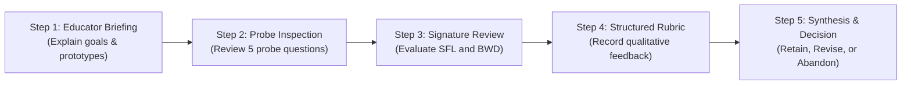

# Educational Probe Review Specification (Phase 5)

## Overview & Scope
This document provides an educational and mathematical review of the 5-item diagnostic probe set used by the Class 3 subtraction diagnostic prototype.

The diagnostic engine ([`src/math_diagnostic/engine.py`](file:///c:/Users/hp/OneDrive/Pictures/Documents/math_diagnostic_ml/src/math_diagnostic/engine.py)), test suite ([`tests/test_engine.py`](file:///c:/Users/hp/OneDrive/Pictures/Documents/math_diagnostic_ml/tests/test_engine.py)), and synthetic evaluation dataset ([`data/synthetic/diagnostic_cases.jsonl`](file:///c:/Users/hp/OneDrive/Pictures/Documents/math_diagnostic_ml/data/synthetic/diagnostic_cases.jsonl)) remain strictly frozen. 

> **PEDAGOGICAL DISCLAIMER:**
> The mathematical signatures analyzed below are **hypothetical software models**. They have not been clinically validated in real classrooms, and they do not prove what a child was thinking. Real-world educational validity requires formal educator review and empirical validation.

---

## 1. Probe-by-Probe Review

The prototype uses a fixed 5-item assessment set comprising **three regrouping probes** and **two non-regrouping controls**:

| Probe ID | Problem ($M - S$) | Digits ($t_M, u_M - t_S, u_S$) | Regrouping Required? | Correct Difference | Primary Intended Diagnostic Role |
| :---: | :---: | :---: | :---: | :---: | :--- |
| **`probe_01`** | $61 - 24$ | $t_M=6, u_M=1$ $t_S=2, u_S=4$ | **Yes** ($1 < 4$) | **37** | First regrouping probe. Tests whether the child recognizes the need to unbundle when $u_S - u_M = 3$. Distinguishes SFL (43) from BWD (47). |
| **`probe_02`** | $72 - 38$ | $t_M=7, u_M=2$ $t_S=3, u_S=8$ | **Yes** ($2 < 8$) | **34** | Second regrouping probe. Tests place-value exchange where $u_S - u_M = 6$. Distinguishes SFL (46) from BWD (44). |
| **`probe_03`** | $83 - 49$ | $t_M=8, u_M=3$ $t_S=4, u_S=9$ | **Yes** ($3 < 9$) | **34** | Third regrouping probe. Evaluates whether the error pattern persists across different digit pairs with the same unit difference ($u_S - u_M = 6$). |
| **`ctrl_01`** | $58 - 23$ | $t_M=5, u_M=8$ $t_S=2, u_S=3$ | **No** ($8 \ge 3$) | **35** | Control item. Verifies basic two-digit vertical column subtraction when unbundling is *not* required. |
| **`ctrl_02`** | $79 - 45$ | $t_M=7, u_M=9$ $t_S=4, u_S=5$ | **No** ($9 \ge 5$) | **34** | Control item. Confirms that the student does not apply regrouping procedures indiscriminately across non-regrouping problems. |

---

## 2. Mathematical Signature Distinguishability

### 2.1 Calculated Expected Answers Across Probes
Under the mathematical formulas defined in Phase 2:
- **Smaller-From-Larger (SFL):** Ones digit $= |u_M - u_S| = u_S - u_M$; Tens digit $= t_M - t_S$.
- **Borrow-Without-Decrement (BWD):** Ones digit $= (u_M + 10) - u_S$; Tens digit $= t_M - t_S$.

| Probe ID | Problem | Correct Answer | Smaller-From-Larger (SFL) | Borrow-Without-Decrement (BWD) | Signature Separation ($\Delta$) |
| :---: | :---: | :---: | :---: | :---: | :---: |
| **`probe_01`** | $61 - 24$ | **37** | **43** ($4-1=3, 6-2=4$) | **47** ($11-4=7, 6-2=4$) | $|43 - 47| = 4$ |
| **`probe_02`** | $72 - 38$ | **34** | **46** ($8-2=6, 7-3=4$) | **44** ($12-8=4, 7-3=4$) | $|46 - 44| = 2$ |
| **`probe_03`** | $83 - 49$ | **34** | **46** ($9-3=6, 8-4=4$) | **44** ($13-9=4, 8-4=4$) | $|46 - 44| = 2$ |

### 2.2 What the Probes Distinguish Mathematically
1. **Zero Collision on This Set:** On all three regrouping probes, $u_S - u_M \neq 5$ (the unit differences are 3, 6, and 6). Because $u_S - u_M \neq 5$, the mathematical signatures for SFL and BWD produce distinct numbers and never collide on these three probes.
2. **Deterministic Divergence:** A student entering `[43, 46, 46]` matches only SFL; a student entering `[47, 44, 44]` matches only BWD.

### 2.3 What the Probes CANNOT Establish About a Child's Reasoning
A final numeric answer is a "black box" that shows the result of calculation, not the cognitive process. The engine **cannot** establish:
- Whether the child used an erroneous mental algorithm or made an isolated arithmetic fact slip.
- Whether the child reversed the visual problem orientation (reading bottom-to-top).
- Whether intermediate regrouping markings were written, erased, or forgotten.
- Whether the child understood the place value of the digits or treated columns as disconnected puzzles.

---

## 3. Alternative Explanations for Target Error Signatures

When a student submits answers matching an error signature, educators must consider multiple competing explanations. The software engine labels these as **hypotheses requiring educator review**, not proven cognitive facts:

### 3.1 Alternative Explanations for the `SMALLER_FROM_LARGER` Signature (`[43, 46, 46]`)
1. **Top-to-Bottom / Bottom-to-Top Visual Reversal:**
   - Instead of subtracting smaller from larger within columns, the child may have simply read the entire problem bottom-to-top:
     - For $61 - 24$, reading bottom-to-top yields $64 - 21 = 43$.
     - For $72 - 38$, reading bottom-to-top yields $78 - 32 = 46$.
     - For $83 - 49$, reading bottom-to-top yields $89 - 43 = 46$.
   - Mathematically, transposing the units digits produces the exact same numeric result ($43, 46, 46$) without necessarily meaning the child believes "subtraction is commutative".
2. **Coincidental Calculation Slips on Specific Digit Pairs:**
   - Single-digit recall slips (e.g., recalling $11 - 4$ as $13 \rightarrow 3$) could coincidentally produce an answer ending in 3.
3. **Visually Driven Guessing:**
   - An 8-year-old child overwhelmed by column regrouping may guess by taking the visible difference of numbers they recognize.

### 3.2 Alternative Explanations for the `BORROW_WITHOUT_DECREMENT` Signature (`[47, 44, 44]`)
1. **Isolated Tens-Column Arithmetic Fact Error:**
   - The child may have executed the unbundling step perfectly (decrementing tens to 5, 6, 7), but made an elementary single-digit subtraction error in the tens column (e.g., computing $5 - 2 = 4$ or $6 - 3 = 4$).
2. **Incomplete Recording of Intermediate Markings:**
   - The child understood that a ten was borrowed and added 10 to ones ($11 - 4 = 7$), but did not cross out the top tens digit in pencil. When returning to subtract the tens column, they subtracted the printed digit ($6 - 2 = 4$).
3. **Transient Memory Slip:**
   - A lapse in short-term working memory between completing the ones-column subtraction and moving to the tens column.

---

## 4. Inherent Limitations of the 5-Probe Design

1. **Small Sample Size (3 Regrouping Items):**
   - Three items provide a minimal baseline for software pattern checking, but are insufficient for psychometric or clinical evaluation. A child making two arithmetic slips can inadvertently mimic a systematic pattern.
2. **Repetition of Structural Results:**
   - `probe_02` ($72 - 38$) and `probe_03` ($83 - 49$) have identical correct answers (**34**) and identical signature outputs (**46** and **44**). 
   - *Risk:* In an actual classroom assessment, an observant child might notice that two consecutive problems yield identical answers and second-guess themselves or copy their previous result.
3. **Absence of Scratchwork & Think-Aloud Evidence:**
   - The system receives only a typed or clicked integer. It has zero visibility into crossed-out numbers, rewritten place values, or finger-counting strategies.
4. **Fatigue and Ordering Effects:**
   - The probes are evaluated in a single batch. If an 8-year-old child fatigues toward the end of a quiz, errors on later probes may reflect inattention rather than conceptual misconceptions.

---

## 5. Curriculum-Review Checklist for Primary Mathematics Educators

This checklist contains neutral questions for primary mathematics educators (e.g., NCERT Class 3 teachers) to review the prototype's assumptions. 

> **Note:** Curricular alignment with NCERT Class 3 (*Math-Magic Book 3*, Chapter 3: "Give and Take") has **not** been verified against official curriculum source materials. This checklist provides the exact framework needed to conduct that verification:

### Part A: Curricular Alignment & Age Appropriateness
- [ ] Are two-digit subtraction problems requiring regrouping ($61 - 24$, $72 - 38$, $83 - 49$) introduced in early or late Class 3 in your syllabus?
- [ ] Is pure vertical column subtraction appropriate for Class 3 diagnostic assessment without pictorial representations (such as 10-rupee currency notes or token cards)?
- [ ] Are the numbers (minuends up to 83) within the standard mental and written calculation range expected of an 8-year-old child?

### Part B: Probe Design & Cognitive Load
- [ ] Is 5 problems (3 regrouping + 2 controls) an appropriate length to probe arithmetic difficulty without causing mental fatigue?
- [ ] Does having the same correct answer (**34**) on two consecutive problems (`probe_02` and `probe_03`) introduce unwanted confusion for young learners?
- [ ] Should control problems be presented first, interleaved, or presented randomly?

### Part C: Diagnostic Plausibility
- [ ] In your classroom experience, how common is the *Smaller-From-Larger* error compared to *Borrow-Without-Decrement*?
- [ ] Do students frequently make other systematic mistakes (such as subtracting tens before ones, or decrementing the wrong column) that this 5-probe set completely misses?
- [ ] Can a teacher make meaningful instructional decisions based on final numeric answers alone, or is examining handwritten scratchwork essential?

### Part D: Teacher Guidance Review
- [ ] Are the recommended activities (e.g., Base-10 Tens-and-Ones Bundling Mat, The Banker's Exchange) practical and familiar in standard primary school classrooms?
- [ ] Does the report disclaimer clearly convey that the software output is a formative suggestion rather than an authoritative grade?

---

## 6. Proposed Expert-Review Protocol

To validate or refine these probes before any classroom deployment, the following qualitative expert review protocol is proposed:

### Protocol Steps:
1. **Participant Selection:** Engage 3 to 5 practicing primary mathematics teachers experienced in teaching Class 3 subtraction with regrouping.
2. **Review Session (30–45 minutes):**
   - Walk through each of the 5 probe questions in vertical format.
   - Present the calculated signature answers ($43, 46, 46$ and $47, 44, 44$) alongside the alternative explanations.
   - Present the generated JSON output and teacher guidance text.
3. **Structured Questionnaire:** Teachers score and comment on:
   - Representativeness of the probe items (1–5 scale).
   - Frequency of observed SFL and BWD errors in their classes (1–5 scale).
   - Practical utility of the recommended hands-on activities.
4. **Data Recording:** All educator feedback will be anonymized and compiled into a qualitative review matrix. 
5. **Ethical Boundary:** **Zero real children or student personal data will be involved.**

---

## 7. Decision Criteria for the Probe Set

The qualitative feedback gathered from the expert-review protocol will govern the next architectural decisions:

| Decision Outcome | Triggering Evidence from Educator Review | Required Next Action |
| :--- | :--- | :--- |
| **RETAIN Current Probes** | Educators confirm that the 5 probe questions are age-appropriate, that SFL and BWD represent the two most common early regrouping hurdles, and that the duplicate answer (34) is acceptable. | Freeze probe definitions and proceed to user-interface prototyping. |
| **REVISE Probe Set** | Educators report that:  1. Having two probes yield answer 34 introduces an artifact; OR 2. A 4th regrouping probe is necessary to reduce coincidental matches; OR 3. Interleaving controls is required to prevent visual guessing. | Update probe definitions to new verified numbers where $u_S - u_M \neq 5$, re-run unit tests, and update synthetic benchmarks. |
| **ABANDON Final-Answer Approach** | Educators indicate that inferring misconceptions from final typed numbers alone is pedagogically misleading, and that diagnostic software must capture step-by-step digit entries or scratchwork. | Shift architectural focus from final-number pattern matching to multi-step scratchpad capture. |

---

## 8. Summary of Unresolved Questions

1. **Curricular Verification:** Official NCERT Class 3 *Math-Magic* textbook chapters must be examined by a curriculum specialist to confirm standard problem formats and vocabulary.
2. **Duplicate Answer Effect:** Whether `probe_02` ($72 - 38 = 34$) and `probe_03` ($83 - 49 = 34$) should be adjusted so all 5 probes have distinct correct answers.
3. **Single vs. Step-by-Step Input:** Whether future versions must capture crossed-out digits or column-by-column entries to eliminate alternative explanations.
